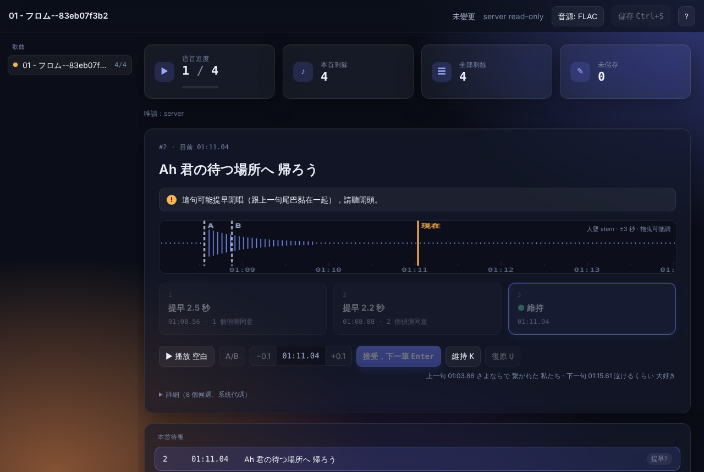
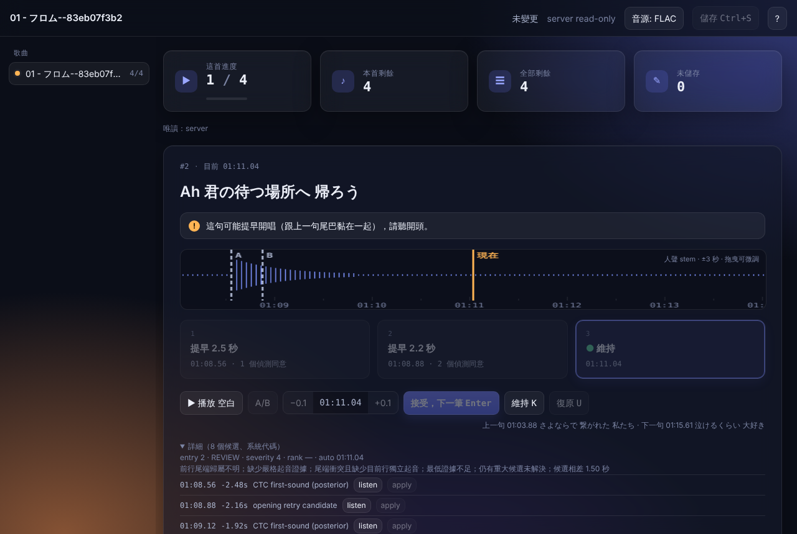
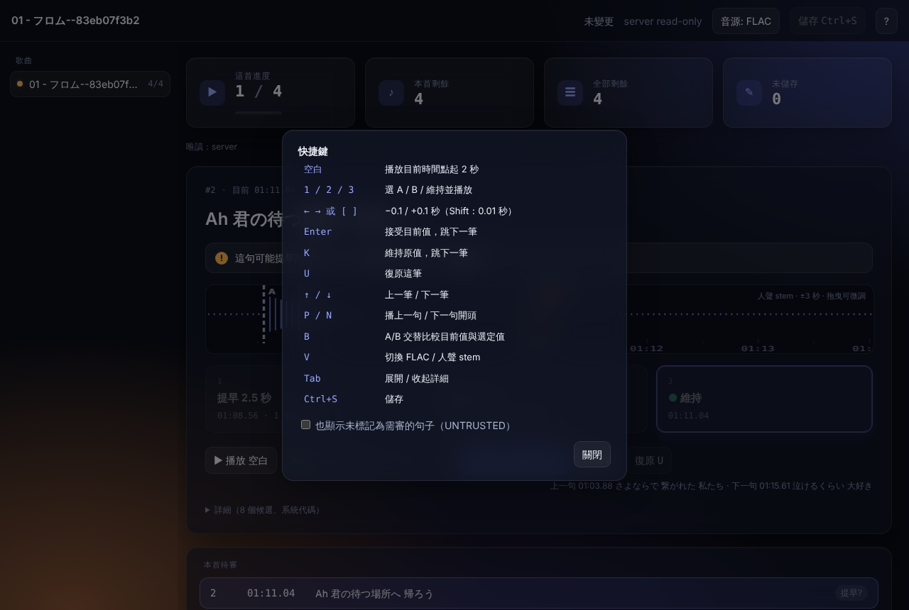

# LRC Timeline Aligner — v1.7.2

在 Windows 本機替歌曲產生 LRC 時間軸。你提供 FLAC 和歌詞，工具會聽音訊、找出每一句開始唱的時間，寫出同名的 `.lrc`，再開一個審核頁，讓你確認它沒把握的句子。

- 歌詞順序不會被改動，工具只決定每一句的開始時間。
- 全部在本機執行，不上傳音訊。
- 主要針對日文歌；英文歌也能跑，但準確度明顯較低（見[已知限制](#已知限制)）。

版本紀錄在 [CHANGELOG.md](CHANGELOG.md)，演算法、評估方法和維護說明在 [docs/TECHNICAL.md](docs/TECHNICAL.md)。

## 畫面



*審核頁一次顯示一句：歌詞、一句話說明為什麼要你聽、標出目前時間和選項 A／B 的波形，以及最多三個選項（`1` / `2` / `3`）。上方數字是這首的進度、剩餘句數和未儲存的修改。*





## 需要什麼

- Windows，Python 3.11（安裝程式不會幫你裝 Python）。
- NVIDIA 顯示卡。驗證過的是 RTX 4070 Ti 12 GB；沒有顯示卡也能用 CPU 跑，但會很慢。
- 約 40 GB 硬碟空間，用來放模型和執行環境。第一次安裝要下載好幾 GB 的檔案。

## 安裝

在解壓縮後的資料夾執行：

```powershell
powershell -NoProfile -ExecutionPolicy Bypass -File .\setup.ps1 -Prefetch
```

它會建立專案自己的 Python 環境（`.venv-asr`），安裝 PyTorch、WhisperX、Demucs 等套件、ffmpeg 和 whisper.cpp，並預先下載所有模型。最後會自動跑一次健康檢查，看到 `DOCTOR PASS` 就是裝好了。

之後想再檢查一次：

```powershell
.\.venv-asr\Scripts\python.exe scripts\doctor.py
```

一定要用 `.venv-asr` 裡的 python 跑，用系統 python 會因為找不到套件而顯示失敗。

## 使用方式

### 1. 準備檔案

把 FLAC 和歌詞放在同一個資料夾，檔名相同。歌詞檔依這個順序找，找到第一個就用：

1. `歌名.lyrics.lrc`
2. `歌名.lyrics.txt`
3. `歌名.txt`

資料夾放哪裡都可以，不必是原本的專輯資料夾。

### 2. 產生 LRC

**方法 A：從審核頁（推薦）**

1. 雙擊 `Review LRC.bat`，瀏覽器會打開審核頁。
2. 按左上的「＋ 新增歌曲」。
3. 按「選擇 FLAC…」或「選擇資料夾…」，或把路徑貼進框裡（一行一個），再按「檢查」。
4. 每首會顯示找到的歌詞檔。顯示「缺歌詞」的，可以按「貼歌詞」貼上，再按「存成歌詞」。
5. 按「開始對齊」。歌曲一次跑一首，每首通常要幾分鐘。跑完的歌會自動出現在左邊清單。
6. 全部完成後按「開始審核」。

已經有 LRC 的歌會顯示「已有 LRC」，要勾「覆蓋現有 LRC 重跑」才會重新產生。

**方法 B：拖曳**

把 FLAC（或整個資料夾）拖到 `Align LRC.bat` 上。跑完後審核頁會自動打開，列出這次跑的歌。

不管哪種方法，LRC 都會寫在 FLAC 旁邊。

### 3. 審核

工具會把沒把握的句子標成「需審」，審核頁一次給你看一句。

- 先按空白鍵聽目前的時間對不對。
- 對的話按 `K`（維持），直接跳下一句。
- 不對的話按 `1` 或 `2` 試聽另外兩個候選時間，或用 `←` `→` 每次微調 0.1 秒，也可以直接在波形上拖曳。找到對的位置後按 `Enter`（接受）。
- 改過時間後，按 `Ctrl+S` 存回 LRC。

「維持」不會改動 LRC，所以只按維持的時候，儲存鈕是灰的，這是正常的。每一句的維持或修改結果都會立刻記錄下來，之後用來調整哪些句子需要審。

之後想再審，雙擊 `Review LRC.bat` 會打開所有跑過的歌：左側上方是「待確認」，還有句子沒審；下方是「已確認」，已經審完，點標題可以收合。把資料夾、FLAC 或 LRC 拖到 `Review LRC.bat`，則審核那裡的檔案。關掉黑色的主控台視窗就會停止審核頁。

### 審核頁快捷鍵

| 按鍵 | 作用 |
| --- | --- |
| 空白 | 從目前時間播放 2 秒 |
| `1` / `2` / `3` | 選 A ／ B ／ 維持，並播放 |
| `←` `→` 或 `[` `]` | 往前／往後 0.1 秒（加 Shift 是 0.01 秒） |
| `Enter` | 接受目前的時間，跳下一句 |
| `K` | 維持原本的時間，跳下一句 |
| `U` | 復原這一句 |
| `↑` / `↓` | 上一句／下一句 |
| `P` / `N` | 播上一句／下一句的開頭 |
| `B` | 在目前時間和選定時間之間交替播放 |
| `V` | 切換播放原曲（FLAC）或只有人聲（stem） |
| `Tab` | 展開／收起詳細資料 |
| `Ctrl+S` | 儲存 |
| `?` | 顯示快捷鍵 |

## 產生的檔案

| 檔案 | 位置 | 內容 |
| --- | --- | --- |
| `歌名.lrc` | FLAC 旁邊 | 播放器讀的歌詞檔。第一行是 `[00:00.00]歌手 - 歌名`，讓播放器在前奏時顯示歌名，不影響其他句的時間。 |
| `*.align-report.json` | `outputs\reports` | 每一句的候選時間、來源和判斷理由。 |
| `*.review.tsv` | `outputs\reports` | 需審句子的清單。 |
| `*.auto.lrc` | `outputs\reports` | 工具原始輸出的備份，人工修改前的版本。 |
| `*.review-edits.json` | `outputs\reports` | 你在審核頁做過的每一次修改。 |
| `*.review-decisions.jsonl` | `outputs\reports` | 每一句審核時選了維持還是修改。 |

## 常見問題

**有些句子我聽起來是對的，為什麼還要我審？**
「需審」代表工具證明不了這句的開頭是對的，例如幾個模型給的時間不一致，或上一句的尾音和這一句的開頭黏在一起。它不代表時間是錯的，所以大部分按 `K` 維持就好。

**LRC 被搬走或刪掉的舊報告怎麼辦？**
它們在歌曲清單裡會收成一行「另有 N 首無法審核」。要清理的話執行 `scripts\archive_stale_reports.py` 查看清單，再加 `--apply` 把它們移到 `outputs\reports\_archive`。這個指令不會刪除任何檔案。

**可以用命令列嗎？**
可以，進階參數都在 `align-lrc.ps1`：

```powershell
powershell -ExecutionPolicy Bypass -File .\align-lrc.ps1 "D:\Music\Song.flac"
```

參數說明見 [docs/TECHNICAL.md](docs/TECHNICAL.md)。

## 已知限制

- 剩下的大誤差集中在所有模型一起失準的地方：人聲很弱、長間奏之後、重複的副歌。這些句子都會被標成需審。
- 負責再次檢查的審核模型都是日文模型，所以英文歌幾乎得不到第二意見。英文歌的「可信」比例不能當作準確率看。
- 歌詞跟實際唱的不一致（少一句、多一句、順序不同）會明顯降低準確度。執行結束時列出的「信心最低五句」通常就在出問題的位置附近。
- 參考數字：在 37 首、1414 句人工校對過的測試歌上，86.92% 的句子誤差在 0.2 秒以內，6.15% 的句子誤差超過 1 秒；日文 30 首是 90.86%，英文 7 首只有 64.46%。這是這批歌的結果，不保證其他歌一樣。

## 開發

- 不需要音檔和模型的檢查（GitHub 上的「Public checks」也是跑這個）：`python .\scripts\check_public.py`
- 完整測試要在裝好執行環境的電腦上跑：`python -m unittest discover -s scripts -p "test_*.py"`，以及 `node scripts\test_review_page.js`。
- 這個 repo 不包含音檔、模型、產生的 LRC 和私人參考答案。
